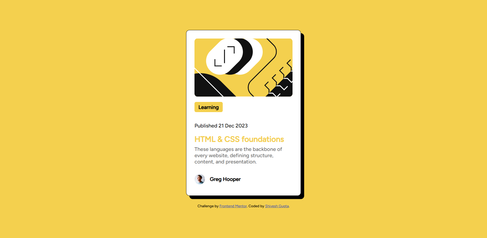

# Frontend Mentor - Blog preview card

A solution to the [Blog preview card challenge on Frontend Mentor](https://www.frontendmentor.io/challenges/blog-preview-card-ckPaj01IcS).

## Table of contents

- [Overview](#overview)
  - [The challenge](#the-challenge)
  - [Links](#links)
- [My process](#my-process)
  - [Built with](#built-with)
  - [What I learned](#what-i-learned)
  - [Continued development](#continued-development)
  - [Useful resources](#useful-resources)
  - [AI collaboration](#ai-collaboration)
- [Running locally](#running-locally)
- [Project structure](#project-structure)
- [Author](#author)
- [Acknowledgments](#acknowledgments)

## Overview

### The challenge

The goal is to recreate a blog preview card from the provided design and show hover and focus states for interactive elements.

The card presents an article category, publication date, title, description, and author.

### Screenshot

### Links

- [Frontend Mentor challenge](https://www.frontendmentor.io/challenges/blog-preview-card-ckPaj01IcS)

## My process

### Built with

- HTML
- CSS
- Flexbox
- Figtree font

### What I learned

This project uses Flexbox to arrange the card content and the author's profile row. It also uses the supplied Figtree font and image assets to match the challenge design.

### Continued development

Areas to keep practicing in future projects include responsive layouts at narrow screen sizes, semantic HTML structure, and clear keyboard focus styles for links.

### Useful resources

- [MDN: Basic concepts of flexbox](https://developer.mozilla.org/en-US/docs/Web/CSS/CSS_flexible_box_layout/Basic_concepts_of_flexbox) - A reference for understanding how Flexbox arranges items.
- [Frontend Mentor](https://www.frontendmentor.io/) - Provides design challenges for practicing frontend development.

### AI collaboration

AI assistance was used to organize this README based on the existing project files. The page's HTML and CSS were already in place.

## Running locally

No build tools or dependencies are required. Open `index.html` in a web browser to view the page.

## Project structure

- `index.html` - Page content
- `style.css` - Page styles
- `assets/images/` - Article illustration, author avatar, and favicon
- `assets/fonts/` - Figtree font files
- `design/` - Challenge design references
- `preview.jpg` - Challenge preview image
- `style-guide.md` - Challenge colors, typography, and layout guidance

## Author

- Shivesh Gupta

## Acknowledgments

- Frontend Mentor for the challenge and starter assets.
